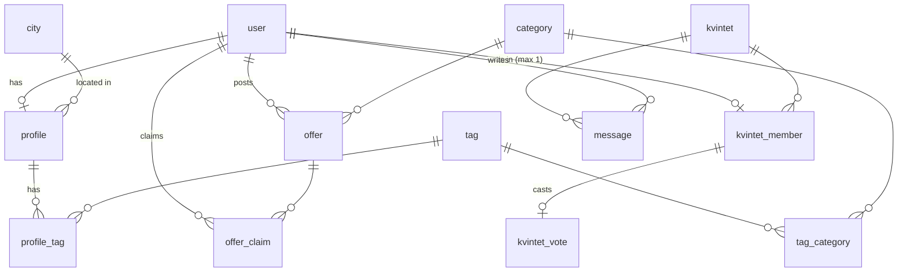

# Kvintet — architecture

Implementation decisions for the Kvintet pilot, so that generated code stays consistent. **What a feature must do lives in the user stories (GitHub issues), not here.** This file holds only the decisions the stories leave open. When a decision here changes, update this file in the same PR.

The stack is given: NestJS + Prisma + Postgres, React + Vite + TanStack Router/Query + shadcn/ui, BetterAuth. The repo started as the Quacker starter template (its example domain has been removed); the product built on it is Kvintet. Layering and DTO validation follow principle 5; the first real module (`profile`) becomes the reference implementation. Treat BetterAuth as a black box, with one exception: the additional fields below (sign-up consent) and the existing `role`.

## 1. Constraints and what follows from them

Pilot scale: ≤ 500 users, tens online at once. One backend container and one Postgres are enough. Everything is served from one origin (`/` → frontend, `/api` → backend), so auth cookies are first-party. Pushing to `main` deploys to production; the backend runs `prisma migrate deploy` on start.

| What we don't have                       | Rule for the code                                                                                                             |
| ---------------------------------------- | ----------------------------------------------------------------------------------------------------------------------------- |
| Staging (`main` is production)           | Small PRs, green CI before merge, only additive migrations (rename or drop in two deploys), no demo data in the production DB |
| Cron / worker                            | Time-based state is **computed when read**, never by a scheduled job                                                          |
| Known instance count, persistent disk    | Backend is **stateless**: no in-memory locks, caches or files on disk. Everything lives in Postgres                           |
| Reliable WebSocket/SSE through the proxy | **Polling** for chat and vote status                                                                                          |
| Outbound e-mail, runtime env access      | No e-mail in the MVP. Do not add new runtime env vars or secrets without asking a human                                       |

## 2. Design principles

1. **The server owns every rule** (capacity, group size, voting, who may see what). The frontend displays and validates for convenience only.
2. **Invariants live in the database:** unique constraints, foreign keys, and transactions with row locks. Never in-process state.
3. **Derive, don't schedule.** "Offer is full / past", "kvintet is formed" and feed suitability come from current rows in the request that reads them.
4. **Privacy by construction.** The feed uses its own DTO without name, e-mail or user id. Admin endpoints return aggregates only. Never log e-mails, names or message bodies; the logs are shared across the course.
5. **One layering everywhere.** Backend module: controller + DTOs → service → repository → domain type; only the repository touches Prisma. Frontend feature: `api/` (zod schema, query options), `hooks/`, `components/`.

## 3. Backend

### Modules (`src/modules/…`)

| Module      | Responsibility                                                           |
| ----------- | ------------------------------------------------------------------------ |
| `account`   | Consent at sign-up, account deletion                                     |
| `profile`   | Profile, questionnaire, availability, location, onboarding status        |
| `reference` | Read-only reference data: tags, categories, cities                       |
| `board`     | Offers, category filter, claiming and releasing spots                    |
| `kvintet`   | Kvintets (forming or active), membership, votes, feed, leaving           |
| `matching`  | Pure scoring functions, no DB access, used by `kvintet` to rank the feed |
| `chat`      | User messages of an active kvintet                                       |
| `admin`     | Aggregated pilot statistics                                              |

Shared (`src/shared/…`):

- **Guards:** `AuthenticatedUserGuard` (signed in), `OnboardedGuard` (profile complete), `AdminGuard` (`role === 'admin'`), `MemberGuard` (caller is in a kvintet; chat additionally requires it to be `ACTIVE`).
- **Errors:** a global exception filter (`shared/errors`) returns `{ statusCode, code, message }` with a stable `code`; the English `message` is for logs and developers, never shown to users. Validation failures (global `ValidationPipe`) use `code: "validation_failed"` plus `errors: [{ field, code }]`, where `code` is the failed class-validator constraint (`isNotEmpty`, `maxLength`, …). The frontend translates by code. A thrown `HttpException` can carry its own code (`new ConflictException({ code: 'kvintet_not_open', message })`); otherwise the code comes from the status. Codes in use: `already_in_kvintet` (409: join, start or feed while the caller already has a kvintet), `kvintet_not_open` (409: join a kvintet that is full or no longer `FORMING`) and `kvintet_not_active` (409: read or send chat messages before the kvintet is `ACTIVE`).

A transaction never spans repositories of different modules. When one use case must write data of two modules, the module that owns the use case writes both, through its own repository (see Leave).

### Data model

Application tables next to BetterAuth's own (`user`, `session`, `account`, `verification`):

| Table             | Key columns                                                                                                                               | Constraints / notes                                                                                                                                                                                                                                                          |
| ----------------- | ----------------------------------------------------------------------------------------------------------------------------------------- | ---------------------------------------------------------------------------------------------------------------------------------------------------------------------------------------------------------------------------------------------------------------------------- |
| `user` (extended) | `codeOfConductAcceptedAt`, `codeOfConductVersion` (`role` already exists)                                                                 | See Sign-up consent below                                                                                                                                                                                                                                                    |
| `profile`         | `userId` PK, `position`, `expectations`, `meetingFrequency` (enum), `weekdays`, `weekends`, `cityId`, `radiusKm`, `onboardingCompletedAt` | `onboardingCompletedAt IS NULL` means the user goes to onboarding                                                                                                                                                                                                            |
| `tag`             | `id`, `slug` (unique)                                                                                                                     | Reference data. **Placeholder list** (from the Figma mocks), to be replaced by the onboarding story (#7); labels live in `tags.*` of the locale files                                                                                                                        |
| `profile_tag`     | `userId`, `tagId`, `kind` (`TEACH` / `LEARN` / `INTEREST`)                                                                                | PK (`userId`, `tagId`, `kind`)                                                                                                                                                                                                                                               |
| `tag_category`    | `tagId`, `categoryId`                                                                                                                     | PK (`tagId`, `categoryId`). Reference data: a tag may count towards several categories. This is how a user's tags are compared with a kvintet's single category; nothing reads it yet                                                                                        |
| `city`            | `id`, `name`, `lat`, `lng`                                                                                                                | Reference data. Distance is haversine, computed in `matching`                                                                                                                                                                                                                |
| `category`        | `id`, `slug` (unique), `sortOrder`                                                                                                        | Reference data, seeded by migration (technology, business, languages, personal-development, leisure). Shared by kvintets and the board                                                                                                                                       |
| `offer`           | `id`, `authorId`, `title`, `description`, `place`, `startsAt`, `capacity`, `categoryId`                                                   | Index (`categoryId`, `startsAt`). `CHECK capacity >= 1`                                                                                                                                                                                                                      |
| `offer_claim`     | `offerId`, `userId`, `createdAt`                                                                                                          | PK (`offerId`, `userId`) prevents double claims                                                                                                                                                                                                                              |
| `kvintet`         | `id` (uuid), `status` (`FORMING` / `ACTIVE`), `title`, `description?`, `categoryId`, `createdAt`, `activatedAt`                           | A `FORMING` kvintet is still open to new members and is what the feed lists; `title` (≤ 120) and `category` are the topic it is found by, `description` (≤ 500) is optional and not shown in the feed yet. Table is called `kvintet` because `group` is an SQL reserved word |
| `kvintet_member`  | `kvintetId`, `userId`, `joinedAt`                                                                                                         | PK (`kvintetId`, `userId`) and **unique `userId`**: a user is in at most one kvintet. Row deleted on leave                                                                                                                                                                   |
| `kvintet_vote`    | `kvintetId`, `userId`, `createdAt`                                                                                                        | FK to `kvintet_member`, `ON DELETE CASCADE`: a vote disappears with its member                                                                                                                                                                                               |
| `message`         | `id` (auto-increment integer), `kvintetId`, `authorId?`, `kind` (`USER` / `SYSTEM`), `body`, `createdAt`                                  | Index (`kvintetId`, `createdAt`). `authorId` is `ON DELETE SET NULL`, so messages are anonymised when an account is deleted. Deleting a kvintet cascades its messages                                                                                                        |

**Reference data** (tags, categories, cities) is inserted by **migrations** with `INSERT … ON CONFLICT DO NOTHING`, so it reaches production through the normal deploy. The seed script is only for local demo users and must never run against production.

**Admin account:** `user.role` already exists and users cannot set it through the API. The admin registers normally, then someone sets `role = 'admin'` in the database.

**Sign-up consent:** `codeOfConductAcceptedAt` and `codeOfConductVersion` are BetterAuth additional fields with `input: false`, like `role`. A `databaseHooks.user.create.before` hook (`shared/auth/hooks/code-of-conduct.hook.ts`) rejects a sign-up whose body lacks `acceptCodeOfConduct: true` with `CODE_OF_CONDUCT_REQUIRED` and sets both values on the server; the current version is the `CODE_OF_CONDUCT_VERSION` constant in `shared/auth/code-of-conduct.ts` (bump it when the text changes). The client sends only the flag, never the timestamp or the version (BetterAuth answers 400 if it does). Any code that signs users up server-side, like the seed, must pass the flag too.

### Critical flows

Each runs in one Prisma `$transaction` that first locks the parent row (`SELECT … FOR UPDATE` through `$queryRaw`), so two concurrent requests cannot both take the last spot. If the locked row no longer exists, the flow returns 404, never a foreign-key error. Quote reserved words and table names in raw SQL. Every flow gets an integration test against a real Postgres.

- **Claim a spot** — lock the offer; reject if it already started, is full, or the caller is its author; insert the claim (the PK rejects a second claim by the same user). Capacity is fixed after posting (no edit endpoint in the MVP).
- **Release a spot** — lock the offer; reject if it already started; delete the claim.
- **Join a kvintet** — lock the kvintet; return 404 if it is gone (a concurrent Leave may have deleted the empty kvintet); reject unless `FORMING` and under 5 members; delete the kvintet's votes; insert the member (the unique `userId` rejects "already in a kvintet"); at 5 members set `ACTIVE` and `activatedAt`.
- **Start a kvintet** — insert a `FORMING` kvintet and the caller's membership in one transaction.
- **Vote** — lock the kvintet; reject unless `FORMING` with 3–4 members; insert the vote; when votes equal members, set `ACTIVE`. A vote agrees to a specific roster, so Join and Leave on a `FORMING` kvintet delete all its votes and everyone votes again; the UI says so. A late joiner can therefore reset progress; accepted for the MVP, since nothing else stops someone joining an open proposal.
- **Leave** — lock the kvintet; delete the member; in an `ACTIVE` kvintet insert a `SYSTEM` message, written by the `kvintet` repository; in a `FORMING` kvintet delete all votes (the roster changed, so earlier votes no longer count; it never auto-activates); delete the kvintet if it is empty. An `ACTIVE` kvintet that drops below 3 members stays active; nothing else happens.
- **Delete account** — one `account` service call: run the Leave flow if the user is in a kvintet, then delete the user. Other tables go by cascade, as story "Delete my account" asks: offers the user posted disappear together with the claims on them. Do not rely on the cascade alone for the membership, because it skips the Leave rules and leaves empty kvintets in the feed.
- **Board listing** — `startsAt > now()` and claim count `< capacity`, filtered by category. "Full" and "past" are never stored.
- **Chat** — only members of an `ACTIVE` kvintet can read or write. Clients poll with `after=<last message id>`; the server returns messages with `id > after` ordered by `id`. A request without a cursor returns the last 50; with `after` it returns at most 100 (`after=0` must not return the whole history), and the client keeps polling until a page comes back shorter than the limit. `before=<oldest id the client has>` returns up to 50 older messages (ascending) for the "Show earlier messages" button; `after` and `before` together are rejected as `validation_failed`. Messages carry the author's name and username (members of an active kvintet see each other's names anyway); `authorId`, name and username are `null` once the author deleted their account, and the UI shows a translated "Deleted member". The client does not append the reply to a sent message to its cache but polls right away, because another member's lower id may be newer than the cache and a cursor past it would skip it. Sending a message locks the `kvintet` row and then re-checks that the caller is still a member and the kvintet is `ACTIVE`; the guard alone is not enough, because a concurrent Leave can pass it. Sequence ids are assigned at insert, not at commit, so every message insert (user or `SYSTEM`) first locks the `kvintet` row. That makes ids commit in order per kvintet and a poll can never skip a message. Message bodies have a maximum length in the DTO and are rendered as text, never HTML.

### Matching

`matching` is pure functions over plain profile objects, unit-tested with fixed fixtures: `scoreMember`, `scoreGroup` (e.g. mean of member scores). Keep the weights in one constant.

Decided, not built yet (the data model is ready: `kvintet.categoryId`, `profile_tag`, `tag_category`): the main signal is **topic fit**, the user's tags that map to the kvintet's one category through `tag_category`, with `LEARN` and `INTEREST` weighted above `TEACH`. The kvintet side is its category only; members' tags and kvintet tags are not compared. Distance and availability overlap add a **soft score** and never hide a kvintet. A kvintet with zero topic fit still shows, ranked last, so a small pilot never gets an empty feed.

Scope: matching **ranks and filters the kvintet feed** and nothing else. Users start kvintets themselves; the algorithm never creates groups or assigns people.

`GET /api/kvintets/feed` loads the caller's profile and every `FORMING` kvintet with 1–4 members together with their profiles, scores and sorts them. Nothing is precomputed. A caller who is already in a kvintet gets `409` (the client redirects to `/overview` with a toast until the My kvintet page exists). So the header can grey out the feed link for members (tooltip: why) instead of bouncing them, `GET /kvintets/membership` answers `{ isMember }`; a direct visit to `/kvintet/feed` still ends in the redirect, so the feed never lists the caller's own kvintet.

Matching is advisory: it only ranks what the feed shows, and joining does not re-check it, so any onboarded user may join any open kvintet by id. The hard rules (size, one kvintet per user) are enforced in the Join flow.

The feed shows each member's `position` and tags, as the story requires, plus `meetingFrequency` when every member picked the same one. **Names are revealed when the kvintet forms**, not when joining a kvintet. The `kvintet` module reads `profile`, `profile_tag` and `tag`; until the onboarding story lands the `profile` table only has `position` and `meetingFrequency`, and a member without a profile row is listed with a generic label. The feed has no matching yet: it returns every open kvintet, newest first. `?category=<slug>` narrows it to one category; an unknown slug is a `400`, not an empty list. The feed page keeps the selected category in the URL (`/kvintet/feed?category=languages`), builds the `CategoryFilter` chips from `GET /reference` and treats a slug that is not in that list as "All", so a stale link never shows an error. In a cohort of a few hundred, rare combinations could identify a person; this is an accepted risk for the pilot. A controller test compares the whole response shape against an allow-list, so a new field cannot leak by accident.

### API

All routes are under `/api`, need a session unless marked public, and are documented in Swagger.

| Method & path                                | Purpose                                 | Guard           |
| -------------------------------------------- | --------------------------------------- | --------------- |
| `GET /reference`                             | Categories (tags, cities to follow)     | public          |
| `GET/PUT /me/profile`                        | Read / save profile + questionnaire     | auth            |
| `DELETE /me`                                 | Delete account                          | auth            |
| `GET /offers?category=`                      | Board listing                           | auth            |
| `POST /offers`                               | Post an offer                           | auth            |
| `POST/DELETE /offers/:id/claim`              | Claim / release a spot                  | auth            |
| `GET /kvintets/feed?category=`               | Ranked open kvintets                    | onboarded       |
| `GET /kvintets/membership`                   | Is the caller in a kvintet?             | auth            |
| `POST /kvintets`                             | Start a kvintet                         | onboarded       |
| `POST /kvintets/:id/members`                 | Join                                    | onboarded       |
| `GET /kvintets/mine`                         | My kvintet, members, vote status        | member          |
| `POST /kvintets/mine/vote`                   | Vote to start                           | member          |
| `DELETE /kvintets/mine/membership`           | Leave                                   | member          |
| `GET /kvintets/mine/messages?after=&before=` | Latest page, or after / before a cursor | member (active) |
| `POST /kvintets/mine/messages`               | Send a message                          | member (active) |
| `GET /admin/stats`                           | Aggregated numbers                      | admin           |

Member-only routes use `mine` instead of `:id`, so a client cannot address someone else's kvintet. Membership comes from the session.

## 4. Frontend

Routes (TanStack Router, file-based). Guards are pathless layout routes (`_Authenticated`, `_Onboarded`, `_Admin`) whose loader checks the session and redirects. `_Onboarded` sends users without a finished profile to `/onboarding`; `_Admin` shows the 404 page to non-admins.

| Route                                        | Access                   |
| -------------------------------------------- | ------------------------ |
| `/`, `/login`, `/signup`, `/code-of-conduct` | public                   |
| `/onboarding`                                | signed in, not onboarded |
| `/overview`, `/profile`                      | signed in + onboarded    |
| `/board`, `/board/new`                       | signed in + onboarded    |
| `/kvintet/feed`, `/kvintet`                  | signed in + onboarded    |

The chat is not a route of its own: an `ACTIVE` kvintet's `/kvintet` page has an Overview and a Messages tab (`/kvintet?tab=messages`), and the chat is mounted, and polled, only while that tab is open. Features may not import each other, so the `kvintet` feature takes the chat as a render prop that the route supplies.
| `/admin` | admin |

- Features live in `src/features/{account,profile,board,kvintet,chat,admin,legal}`. Business decisions stay in hooks and on the server, not in components.
- Filters that change the list (board category) live in the URL search params.
- Polling uses TanStack Query `refetchInterval` with `refetchIntervalInBackground: false`: chat 5 s, my kvintet (vote status) 10 s. Chat appends the result of `after=<last id>` to the cache.
- **Localization:** react-i18next with one JSON file per language in `src/i18n/locales`, registered in `src/i18n/index.ts` (English and Czech). The language comes from `localStorage`, then the browser, falling back to English; the header switcher changes it. All UI text uses `t()` keys, dates and numbers go through `lib/date.ts`, and server errors are translated by `lib/errorMessage.ts` from their `code` (backend codes under `errors.*`, BetterAuth codes under `errors.auth.*`, validation constraints under `validation.*`). Backend text that users see (emails) is not localized yet.
- UI rules are in [`DESIGN.md`](../DESIGN.md).

## 5. Testing

- Unit tests for services, and especially for `matching`.
- Claim, join, vote, leave and delete-account need integration tests against a real Postgres. The race tests fire N requests with `Promise.all` at the last spot or the fifth seat. Also cover "leave after the others voted". The first story that needs them adds a `postgres` service container to `ci.yml`. Never point tests at the production database.
- Auth: a sign-up payload with `role: "admin"` or its own consent timestamp is ignored, and sign-up without consent fails.
- Every route has a test for 401 (no session), 403 (not onboarded, not admin, not a member). A non-member never gets data from another kvintet.
- All free text (offers, messages) has a maximum length in its DTO. Rate limiting is not part of the MVP.
