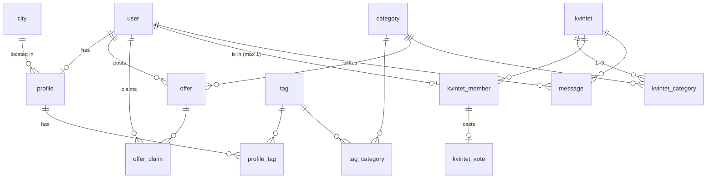

# Kvintet — architecture

Implementation decisions for the Kvintet pilot, so that generated code stays consistent. **What a feature must do lives in the user stories (GitHub issues), not here.** This file holds only the decisions the stories leave open. When a decision here changes, update this file in the same PR.

The stack is given: NestJS + Prisma + Postgres, React + Vite + TanStack Router/Query + shadcn/ui, BetterAuth. The repo started as the Quacker starter template (its example domain has been removed); the product built on it is Kvintet. Layering and DTO validation follow principle 5; the first real module (`profile`) becomes the reference implementation. Treat BetterAuth as a black box, with one exception: the additional fields below (sign-up consent) and the existing `role`.

## 1. Constraints and what follows from them

Pilot scale: ≤ 500 users, tens online at once. One backend container and one Postgres are enough. Everything is served from one origin (`/` → frontend, `/api` → backend), so auth cookies are first-party. Pushing to `main` deploys to production; the backend runs `prisma migrate deploy` on start.

| What we don't have                       | Rule for the code                                                                                                             |
| ---------------------------------------- | ----------------------------------------------------------------------------------------------------------------------------- |
| Staging (`main` is production)           | Small PRs, green CI before merge, only additive migrations (rename or drop in two deploys), no demo data in the production DB |
| Cron / worker                            | Time-based state is **computed when read**, never by a scheduled job                                                          |
| Known instance count, persistent disk    | Backend is **stateless**: no in-memory locks, caches or files on disk. Everything lives in Postgres                           |
| Reliable WebSocket/SSE through the proxy | **Polling** for chat and vote status                                                                                          |
| Outbound e-mail, runtime env access      | No e-mail in the MVP. Do not add new runtime env vars or secrets without asking a human                                       |

## 2. Design principles

1. **The server owns every rule** (capacity, group size, voting, who may see what). The frontend displays and validates for convenience only.
2. **Invariants live in the database:** unique constraints, foreign keys, and transactions with row locks. Never in-process state.
3. **Derive, don't schedule.** "Offer is full / past", "kvintet is formed" and feed suitability come from current rows in the request that reads them.
4. **Privacy by construction.** The feed uses its own DTO without name, e-mail or user id. While a kvintet is `FORMING`, peer member `userId`s returned by `GET /kvintets/mine` are masked with deterministic ephemeral HMAC tokens (`anon-[hash]`) derived from an HMAC secret, the kvintet id, and user id, preventing pre-activation user deanonymization or profile scraping. Real database `userId`s are only unmasked once the kvintet transitions to `ACTIVE`. Admin endpoints return aggregates only, except the matching-data CSV export, whose rows carry a keyed pseudonym instead of a user id (see Matching data). Never log e-mails, names or message bodies; the logs are shared across the course.
5. **One layering everywhere.** Backend module: controller + DTOs → service → repository → domain type; only the repository touches Prisma. Frontend feature: `api/` (zod schema, query options), `hooks/`, `components/`.

## 3. Backend

### Modules (`src/modules/…`)

| Module      | Responsibility                                                           |
| ----------- | ------------------------------------------------------------------------ |
| `account`   | Consent at sign-up, account deletion                                     |
| `profile`   | Profile, questionnaire, availability, location, onboarding status        |
| `reference` | Read-only reference data: tags, categories, cities                       |
| `board`     | Offers, category filter, claiming and releasing spots                    |
| `kvintet`   | Kvintets (forming or active), membership, votes, feed, leaving           |
| `matching`  | Pure scoring functions, no DB access, used by `kvintet` to rank the feed |
| `chat`      | User messages of an active kvintet                                       |
| `admin`     | Aggregated pilot statistics                                              |

Shared (`src/shared/…`):

- **Guards:** `AuthenticatedUserGuard` (signed in), `OnboardedGuard` (profile complete), `AdminGuard` (`role === 'admin'`), `MemberGuard` (caller is in a kvintet; chat additionally requires it to be `ACTIVE`).
- **Errors:** a global exception filter (`shared/errors`) returns `{ statusCode, code, message }` with a stable `code`; the English `message` is for logs and developers, never shown to users. Validation failures (global `ValidationPipe`) use `code: "validation_failed"` plus `errors: [{ field, code }]`, where `code` is the failed class-validator constraint (`isNotEmpty`, `maxLength`, …). The frontend translates by code. A thrown `HttpException` can carry its own code (`new ConflictException({ code: 'kvintet_not_open', message })`); otherwise the code comes from the status. Codes in use: `already_in_kvintet` (409: join, start or feed while the caller already has a kvintet), `kvintet_not_open` (409: join a kvintet that is full or no longer `FORMING`) and `kvintet_not_active` (409: read or send chat messages before the kvintet is `ACTIVE`).

A transaction never spans repositories of different modules. When one use case must write data of two modules, the module that owns the use case writes both, through its own repository (see Leave).

### Rate Limiting and Network Topology

Abuse prevention and DoS mitigation operate on two coordinated layers:

1. **NestJS Global Throttler (`@nestjs/throttler`):**
   - **Global ceiling:** 300 requests per 60 seconds per client IP across all API routes (`ThrottlerGuard`). This generous limit accommodates high-density student campus networks sharing a single NAT gateway without falsely throttling concurrent peers.
   - **Polling exemptions:** Frequent background polling endpoints (`@SkipThrottle()`) are explicitly excluded from consuming the IP budget: `GET /kvintets/mine/messages` (chat polling), `GET /kvintets/mine/messages/unread` (header badge polling), `GET /kvintets/mine` (roster/vote polling), and `GET /health`.
   - **Chat burst protection:** `POST /kvintets/mine/messages` enforces a strict `@Throttle({ default: { limit: 20, ttl: 60000 } })` to mitigate automated spam floods in active groups.

2. **BetterAuth Authentication Rate Limiting:**
   - **Session & reading ceiling:** 100 requests per 60 seconds baseline across `/api/auth/*` to guarantee `get-session` navigation checks never trigger unexpected `429 Too Many Requests`.
   - **Credential endpoints (`customRules`):** Tight limits on sensitive mutation routes to block brute-force attacks:
     - `/sign-in/email`: 10 req / 60s
     - `/sign-up/email`: 5 req / 60s

3. **Reverse Proxy & Client IP Resolution (`trust proxy`):**
   - Express is configured with `appInstance.set('trust proxy', trustProxyValue)` where `trustProxyValue` defaults to `1` (or the `TRUST_PROXY` environment variable).
   - In production on Coolify, incoming external requests terminate TLS at the Coolify reverse proxy (Traefik edge) and are forwarded over the internal Docker network directly to the backend container. The frontend container is an Nginx static file host that does not proxy API calls. `trust proxy: 1` correctly extracts the real client IP from the single edge proxy hop (`X-Forwarded-For`). If upstream proxy hops (e.g. Cloudflare or external CDN) are introduced, `TRUST_PROXY` can be set to the corresponding hop count.

### Data model

Application tables next to BetterAuth's own (`user`, `session`, `account`, `verification`):

| Table              | Key columns                                                                                                                                                  | Constraints / notes                                                                                                                                                                                                                                                                                                                                                                                                                                                                                                                       |
| ------------------ | ------------------------------------------------------------------------------------------------------------------------------------------------------------ | ----------------------------------------------------------------------------------------------------------------------------------------------------------------------------------------------------------------------------------------------------------------------------------------------------------------------------------------------------------------------------------------------------------------------------------------------------------------------------------------------------------------------------------------- |
| `user` (extended)  | `codeOfConductAcceptedAt`, `codeOfConductVersion` (`role` already exists)                                                                                    | See Sign-up consent below                                                                                                                                                                                                                                                                                                                                                                                                                                                                                                                 |
| `profile`          | `userId` PK, `position`, `expectations`, `meetingFrequency` (enum), `weekdays`, `weekends`, `cityId`, `radiusKm`, `onboardingCompletedAt`, `tourCompletedAt` | `onboardingCompletedAt IS NULL` means the user goes to onboarding. `tourCompletedAt` (nullable) is when the user finished or skipped the product tour, so the tour follows the account across devices; the migration set it for every existing profile, so only users who sign up later get the tour                                                                                                                                                                                                                                      |
| `tag`              | `id`, `slug` (unique)                                                                                                                                        | Reference data. **Placeholder list** (from the Figma mocks), to be replaced by the onboarding story (#7); labels live in `tags.*` of the locale files                                                                                                                                                                                                                                                                                                                                                                                     |
| `profile_tag`      | `userId`, `tagId`, `kind` (`TEACH` / `LEARN` / `INTEREST`)                                                                                                   | PK (`userId`, `tagId`, `kind`)                                                                                                                                                                                                                                                                                                                                                                                                                                                                                                            |
| `tag_category`     | `tagId`, `categoryId`                                                                                                                                        | PK (`tagId`, `categoryId`). Reference data: a tag may count towards several categories. This is how a user's tags are compared with a kvintet's categories; nothing reads it yet                                                                                                                                                                                                                                                                                                                                                          |
| `city`             | `id`, `name`, `lat`, `lng`                                                                                                                                   | Reference data. Distance is haversine, computed in `matching`                                                                                                                                                                                                                                                                                                                                                                                                                                                                             |
| `category`         | `id`, `slug` (unique), `sortOrder`                                                                                                                           | Reference data, seeded by migration: software-development, data-ai, cloud-security, design-product, business, languages, personal-development, leisure. The original broad `technology` was split into the first four (its kvintets moved to software-development) and deleted. Shared by kvintets and the board                                                                                                                                                                                                                          |
| `offer`            | `id`, `authorId`, `title`, `description`, `place`, `startsAt`, `capacity`, `categoryId`                                                                      | Index (`categoryId`, `startsAt`). `CHECK capacity >= 1`                                                                                                                                                                                                                                                                                                                                                                                                                                                                                   |
| `offer_claim`      | `offerId`, `userId`, `createdAt`                                                                                                                             | PK (`offerId`, `userId`) prevents double claims                                                                                                                                                                                                                                                                                                                                                                                                                                                                                           |
| `kvintet`          | `id` (uuid), `status` (`FORMING` / `ACTIVE`), `title`, `description`, `createdAt`, `activatedAt`                                                             | A `FORMING` kvintet is still open to new members and is what the feed lists; `title` (≤ 120) and its categories are the topic it is found by, `description` (10–280; rows created earlier may hold up to 500) is required and shown on feed cards, clamped to three lines with "Show more". Kvintets started before it was required, without one, got their title as the description in the migration that made it `NOT NULL`. Table is called `kvintet` because `group` is an SQL reserved word.                                         |
| `kvintet_category` | `kvintetId`, `categoryId`                                                                                                                                    | PK (`kvintetId`, `categoryId`), cascades with the kvintet. 1–3 rows per kvintet, chosen when it is started and never edited (the DTO enforces the count).                                                                                                                                                                                                                                                                                                                                                                                 |
| `kvintet_member`   | `kvintetId`, `userId`, `joinedAt`, `lastReadMessageId`, `beginsSeenAt`                                                                                       | PK (`kvintetId`, `userId`) and **unique `userId`**: a user is in at most one kvintet. Row deleted on leave. `lastReadMessageId` (default 0) is the chat's read mark: the newest message the member has seen, so it disappears with the membership. Only the chat repository writes it (a deliberate exception to "a module writes only its own tables": one column, kept next to the membership so it needs no extra table or cleanup). `beginsSeenAt` (nullable) is when the member first opened the "Kvintet begins" page; see Frontend |
| `kvintet_vote`     | `kvintetId`, `userId`, `createdAt`                                                                                                                           | FK to `kvintet_member`, `ON DELETE CASCADE`: a vote disappears with its member                                                                                                                                                                                                                                                                                                                                                                                                                                                            |
| `message`          | `id` (auto-increment integer), `kvintetId`, `authorId?`, `kind` (`USER` / `SYSTEM`), `body`, `createdAt`                                                     | Index (`kvintetId`, `createdAt`). `authorId` is `ON DELETE SET NULL`, so messages are anonymised when an account is deleted. Deleting a kvintet cascades its messages                                                                                                                                                                                                                                                                                                                                                                     |

Matching data (story #132), outside the diagram. Nothing in the app reads these tables; only the admin export does. `userId` is nullable with `ON DELETE SET NULL`, so a deleted account leaves anonymous rows:

| Table            | Key columns                                                                                                                                     | Notes                                                                                                                                                                                                                                |
| ---------------- | ----------------------------------------------------------------------------------------------------------------------------------------------- | ------------------------------------------------------------------------------------------------------------------------------------------------------------------------------------------------------------------------------------ |
| `feed_snapshot`  | `id`, `userId?`, `createdAt`, `fallback`, `items` (JSON `[{ kvintetId, score }]` in feed order)                                                 | One row per feed load, unless the order equals the user's latest snapshot. The newest 50 per user are kept; older ones are deleted in the same transaction as the insert (no cron). The score is internal and never sent to a client |
| `membership_log` | `id`, `userId?`, `kvintetId` (no FK), `source` (`STARTED` / `JOINED`), `joinedAt`, `leftAt?`, `snapshotId?`, `position?`, `listSize?`, `score?` | One row per stay. `position` (0-based), `listSize` and `score` are copied from the user's latest snapshot that listed the kvintet; null when they joined by a direct link or the kvintet was not listed                              |
| `kvintet_log`    | `kvintetId` (PK, no FK), `createdAt`, `activatedAt?`, `endedAt?`                                                                                | `endedAt` is set when the kvintet is deleted because its last member left. The migration backfilled rows for existing kvintets and members (the earliest member counts as the one who started it)                                    |

**Reference data** (tags, categories, cities) is inserted by **migrations** with `INSERT … ON CONFLICT DO NOTHING`, so it reaches production through the normal deploy. The seed script is only for local demo users and must never run against production.

**Data access and portability (#178):** there is deliberately no export endpoint and no download in the app. The profile page ("Your data") tells users to write to `SUPPORT_EMAIL` (`apps/frontend/src/config/support.ts`) from their account's address, and the admin who reads that mailbox collects the data from the database and answers by hand. GDPR does not require self-service, but the manual route only works if all of this holds:

- **Mailbox:** it exists on a domain the team controls and someone reads it. The one-month clock starts when a request arrives, read or not. `support@kvintet.cz` is a placeholder until confirmed.
- **Deadline and cost:** answer within one month, free of charge. A complex request may take two months longer if the person is told why within the first month (Art. 12(3)). A request that arrives another way counts too.
- **Identity:** send the data only to the e-mail address stored on the account. A request from another address is answered by asking them to write from that one, or to confirm who they are in another proportionate way. Do not ask for an ID document.
- **Contents:** one JSON file with the person's `user` row, `account` (sign-in provider and dates), `session` (IP address, user agent, dates), pending `verification` entries, `profile` with its city and tags, `kvintet_member` with the kvintet's title and description, `kvintet_vote`, the `message` rows they wrote, `feed_snapshot` and `membership_log`; also server or proxy log entries about them, if any are kept. Leave out password hashes and session and OAuth tokens, and other people's data (their messages, names, ids). A new table or column with personal data is added to this list in the same PR.
- **Covering note:** purposes, categories of data, recipients, retention, where data did not come from the person, how the feed ranks kvintets, their rights (rectification, erasure, restriction, objection) and the right to complain to the ÚOOÚ (Art. 15(1)).
- **Sending:** an encrypted archive, with the password sent separately.
- **Record:** the date received, the date answered and what was sent.

**Admin account:** `user.role` already exists and users cannot set it through the API. The admin registers normally, then someone sets `role = 'admin'` in the database. The admin is otherwise a regular user: one extra page, no extra access. Chat stays behind `MemberGuard`, so an admin reads only the chat of a kvintet they joined themselves.

**Admin stats:** `GET /admin/stats` returns seven integers and nothing else: `users { registered, onboarded, activeToday }` and `kvintets { total, active, formingSmall (1–2 members), formingReady (3–4) }`. "Active today" is derived, not stored: distinct users with a `session.updatedAt` since 00:00 UTC. BetterAuth's `session.updateAge` is one hour so that a returning user's session is refreshed on their first request of the day; someone who signs in and out again the same day is not counted. Board numbers join when the `board` module exists.

**Sign-up consent:** `codeOfConductAcceptedAt` and `codeOfConductVersion` are BetterAuth additional fields with `input: false`, like `role`. A `databaseHooks.user.create.before` hook (`shared/auth/hooks/code-of-conduct.hook.ts`) rejects a sign-up whose body lacks `acceptCodeOfConduct: true` with `CODE_OF_CONDUCT_REQUIRED` and sets both values on the server; the current version is the `CODE_OF_CONDUCT_VERSION` constant in `shared/auth/code-of-conduct.ts` (bump it when the text changes). The client sends only the flag, never the timestamp or the version (BetterAuth answers 400 if it does). Any code that signs users up server-side, like the seed, must pass the flag too.

### Critical flows

Each runs in one Prisma `$transaction` that first locks the parent row (`SELECT … FOR UPDATE` through `$queryRaw`), so two concurrent requests cannot both take the last spot. If the locked row no longer exists, the flow returns 404, never a foreign-key error. Quote reserved words and table names in raw SQL. Every flow gets an integration test against a real Postgres.

- **Claim a spot** — lock the offer; reject if it already started, is full, or the caller is its author; insert the claim (the PK rejects a second claim by the same user). Capacity is fixed after posting (no edit endpoint in the MVP).
- **Release a spot** — lock the offer; reject if it already started; delete the claim.
- **Matching data** — written in the same transactions as the flows below, by the `kvintet` repository: Start inserts `kvintet_log` and a `STARTED` `membership_log` row; Join inserts a `JOINED` row (with the position from the caller's latest snapshot that listed the kvintet); activation (Join at 5, Vote) sets `kvintet_log.activatedAt`; Leave sets `membership_log.leftAt` and, when the kvintet is deleted, `kvintet_log.endedAt`. Delete account goes through Leave, so its stay is closed before the user row disappears. The feed snapshot is written by the service on each feed load and is best effort: a failure is logged without personal data and the feed still answers.
- **Join a kvintet** — lock the kvintet; return 404 if it is gone (a concurrent Leave may have deleted the empty kvintet); reject unless `FORMING` and under 5 members; delete the kvintet's votes; insert the member (the unique `userId` rejects "already in a kvintet"); at 5 members set `ACTIVE` and `activatedAt` and insert the chat's first line, a `SYSTEM` message with the body `kvintet_started` (a code the client translates, not display text).
- **Start a kvintet** — insert a `FORMING` kvintet, its 1–3 `kvintet_category` rows and the caller's membership in one transaction. Any unknown category slug rejects the whole request as `validation_failed` on `categorySlugs`.
- **Vote** — lock the kvintet; reject unless `FORMING` with 3–4 members; insert the vote; when votes equal members, set `ACTIVE` (with the same `kvintet_started` `SYSTEM` line as Join, in the same transaction). A vote agrees to a specific roster, so Join and Leave on a `FORMING` kvintet delete all its votes and everyone votes again; the UI says so. A late joiner can therefore reset progress; accepted for the MVP, since nothing else stops someone joining an open proposal.
- **Leave** — lock the kvintet; delete the member; in an `ACTIVE` kvintet insert a `SYSTEM` message, written by the `kvintet` repository; in a `FORMING` kvintet delete all votes (the roster changed, so earlier votes no longer count; it never auto-activates); delete the kvintet if it is empty. An `ACTIVE` kvintet that drops below 3 members stays active; nothing else happens.
- **Delete account** — one atomic `account` repository transaction: if the user is in a kvintet, lock it, run the Leave flow via `kvintetRepository.leaveInTransaction` (reset votes on `FORMING`, delete kvintet if last member), then delete the user. Other tables go by cascade, as story "Delete my account" asks: profile, sessions, accounts, offers and claims disappear, while sent chat messages have their `authorId` set to `null` per schema foreign key. Do not rely on the cascade alone for the membership, because it skips the Leave rules and leaves empty kvintets in the feed.
- **Board listing** — `startsAt > now()` and claim count `< capacity`, filtered by category. "Full" and "past" are never stored.
- **Chat** — only members of an `ACTIVE` kvintet can read or write. Clients poll with `after=<last message id>`; the server returns messages with `id > after` ordered by `id`. A request without a cursor returns the last 50; with `after` it returns at most 100 (`after=0` must not return the whole history), and the client keeps polling until a page comes back shorter than the limit. `before=<oldest id the client has>` returns up to 50 older messages (ascending) for the "Show earlier messages" button; `after` and `before` together are rejected as `validation_failed`. Messages carry the author's name and username (members of an active kvintet see each other's names anyway); `authorId`, name and username are `null` once the author deleted their account, and the UI shows a translated "Deleted member". The client does not append the reply to a sent message to its cache but polls right away, because another member's lower id may be newer than the cache and a cursor past it would skip it. Sending a message locks the `kvintet` row and then re-checks that the caller is still a member and the kvintet is `ACTIVE`; the guard alone is not enough, because a concurrent Leave can pass it. Sequence ids are assigned at insert, not at commit, so every message insert (user or `SYSTEM`) first locks the `kvintet` row. That makes ids commit in order per kvintet and a poll can never skip a message. Message bodies have a maximum length in the DTO and are rendered as text, never HTML.
- **Unread** — each member has a read mark, `kvintet_member.lastReadMessageId`. The count is the `USER` messages of the kvintet with `id` above the mark whose author is not the caller (messages from a deleted account still count; `SYSTEM` lines and one's own messages never do). `GET /kvintets/mine/messages/unread` answers `{ active, count }` and, unlike the other chat routes, answers a `FORMING` kvintet with `active: false, count: 0` instead of `409`, because the app header polls it every 10 s and uses `active` to decide whether to show the chat link at all. `POST /kvintets/mine/messages/read` takes the newest id the client has shown and is one `UPDATE` that only raises the mark (`GREATEST`) and caps it at the kvintet's newest message (`LEAST … MAX(message.id)`), so a made-up id cannot hide messages that arrive later; matching no row (the caller just left) is not an error. The chat panel calls it whenever it has displayed a newer message while the tab is visible. The column defaults to 0 for new members (a kvintet's chat only exists once it is `ACTIVE`, when nobody can join any more), and a second migration set every member that already existed to the newest message of their kvintet, so a deploy does not turn a whole chat history into unread.

### Matching

`matching` (`modules/matching/matching.ts`) is pure functions over plain profile objects, with no database access, unit-tested with fixed fixtures: `scoreKvintet(me, kvintet)` returns a 0–100 score and the reasons behind it. The weights (`MATCH_WEIGHTS`) and the cut-off (`MATCH_THRESHOLD`, 30) are constants; tune them from pilot data.

Criteria, each 0–1 and weighted (sum 100):

| Criterion (weight)   | How                                                                                                                                                                                 |
| -------------------- | ----------------------------------------------------------------------------------------------------------------------------------------------------------------------------------- |
| Topic fit (30)       | The caller's tags that count towards the kvintet's categories through `tag_category`, `LEARN` and `INTEREST` 1, `TEACH` 0.5, full at 2; the best of the kvintet's categories counts |
| Complementarity (25) | The caller's `LEARN` against members' `TEACH` (1), `TEACH` against `LEARN` (0.75), shared `INTEREST` (0.5), full at 3; a tag counts when any member covers it                       |
| Availability (15)    | Per member, half for days and half for parts of the day, then the mean                                                                                                              |
| Distance (10)        | Per member, haversine distance within the smaller of the two radii: `1 − d / (2 · radius)`, 0 beyond it; members without a location are left out of the mean                        |
| Frequency (8)        | Per member: same 1, neighbouring 0.5, weekly against monthly 0                                                                                                                      |
| Expectations (6)     | Per member, overlap of the questionnaire's expectations                                                                                                                             |
| Role mix (6)         | Among members who picked roles, the share who have none of the caller's roles: a mix is the point; with no roles on either side it is neutral                                       |

Data one side has not filled in scores a neutral 0.5, so it neither helps nor hurts. Distance, availability and the other soft criteria never hide a kvintet on their own; only the total score does.

The feed keeps kvintets scoring at least `MATCH_THRESHOLD`, best first, with equal scores newest first. When none reach it, it lists every open kvintet, best first, with `fallback: true`, and the page says nothing fits closely; a small pilot never gets an empty feed because of matching. Each item carries up to three **reasons**, strongest first: stable codes (`learn`/`teach`/`interest` with a tag, `topic` with a category, `availability`, `frequency`, `roleMix`) that the frontend translates. **The score and distances are never sent**: no numbers about people on screen (F-36). There is deliberately **no distance reason**: the caller sets their own point and radius, so a yes/no "nearby" on a one-member kvintet would let them locate that member by moving their point and reloading. Distance still moves the score, and with it the order and the threshold cut, so the same probe is possible in a much weaker form (10 of 100 points, mixed with the other criteria); like rare tag combinations, this is an accepted risk for the pilot.

**Matching data** (story #109 decided to collect data with this rule-based feed first, then tune `MATCH_WEIGHTS` or train on it). Collected: the ranked feed with scores per load, the position and score of the kvintet when a user joined, join and leave times (stay length), time from onboarding to a user's first join, the best score a never-joined user's feeds showed, and how long a kvintet was listed until it started or was disbanded. `GET /admin/export/:dataset` (`feed`, `memberships`, `kvintets`, `users`) returns each as `;`-separated CSV (what Czech spreadsheet locales open as columns) with ids, numbers and ISO dates only; numbers use a decimal point. Users appear as `HMAC-SHA256(BETTER_AUTH_SECRET, "export:" + userId)` cut to 12 hex characters: the same person gets the same token, which cannot be traced to an account without the secret; rows of deleted accounts have an empty cell. The scores never appear in any user-facing response (F-36). Users are told on the code-of-conduct page (`CODE_OF_CONDUCT_VERSION` 1.1); only new sign-ups accept that version, and existing users are not asked again. Accepted risks for the pilot: the best score of a user who never joined covers only their last 50 feed loads; rare tag combinations with timestamps in a few hundred users can still point at one person; the first load of a changed feed counts as an impression even if the user never scrolled to it.

Scope: matching **ranks and filters the kvintet feed** and nothing else. Users start kvintets themselves; the algorithm never creates groups or assigns people.

`GET /api/kvintets/feed` loads the caller's profile and every `FORMING` kvintet with 1–4 members together with their profiles, scores and sorts them, and answers `{ items, fallback }`. Nothing is precomputed, so a profile change shows on the next load. A caller who is already in a kvintet gets `409` (the client redirects to `/overview` with a toast). So the header can grey out the feed link for members (tooltip: why) instead of bouncing them, `GET /kvintets/membership` answers `{ isMember }`; a direct visit to `/kvintet/feed` still ends in the redirect, so the feed never lists the caller's own kvintet.

Matching is advisory: it only ranks what the feed shows, and joining does not re-check it, so any onboarded user may join any open kvintet by id. The hard rules (size, one kvintet per user) are enforced in the Join flow.

The feed shows each member's `position` and tags, as the story requires, plus `meetingFrequency` when every member picked the same one, and `commonAvailability` (the days and parts of the day every member picked: five booleans, never a place, so a one-member kvintet reveals nothing about where its member lives). **Names are revealed when the kvintet forms**, not when joining a kvintet. The `kvintet` module reads `profile`, `profile_tag` and `tag`; until the onboarding story lands the `profile` table only has `position` and `meetingFrequency`, and a member without a profile row is listed with a generic label. Each item lists all of the kvintet's `categories`, in reference order, and its `description` (free text from whoever started it). `?category=<slug>` narrows it to kvintets that have that category among theirs; an unknown slug is a `400`, not an empty list. The feed page keeps the selected category in the URL (`/kvintet/feed?category=languages`), builds the `CategoryFilter` chips from `GET /reference` and treats a slug that is not in that list as "All", so a stale link never shows an error. In a cohort of a few hundred, rare combinations could identify a person; this is an accepted risk for the pilot. A controller test compares the whole response shape against an allow-list, so a new field cannot leak by accident.

### API

All routes are under `/api`, need a session unless marked public, and are documented in Swagger.

| Method & path                                | Purpose                                  | Guard           |
| -------------------------------------------- | ---------------------------------------- | --------------- |
| `GET /reference`                             | Categories, tags with categories, cities | public          |
| `GET/PUT /me/profile`                        | Read / save profile + questionnaire      | auth            |
| `POST /me/profile/tour-completed`            | Mark the product tour as done or skipped | auth            |
| `DELETE /me`                                 | Delete account                           | auth            |
| `GET /offers?category=`                      | Board listing                            | auth            |
| `POST /offers`                               | Post an offer                            | auth            |
| `POST/DELETE /offers/:id/claim`              | Claim / release a spot                   | auth            |
| `GET /kvintets/feed?category=`               | Ranked open kvintets                     | onboarded       |
| `GET /kvintets/membership`                   | Is the caller in a kvintet?              | auth            |
| `POST /kvintets`                             | Start a kvintet                          | onboarded       |
| `POST /kvintets/:id/members`                 | Join                                     | onboarded       |
| `GET /kvintets/mine`                         | My kvintet, members, vote status         | member          |
| `POST /kvintets/mine/vote`                   | Vote to start                            | member          |
| `POST /kvintets/mine/begins-seen`            | Mark the "Kvintet begins" page as seen   | member          |
| `DELETE /kvintets/mine/membership`           | Leave                                    | member          |
| `GET /kvintets/mine/messages?after=&before=` | Latest page, or after / before a cursor  | member (active) |
| `POST /kvintets/mine/messages`               | Send a message                           | member (active) |
| `GET /kvintets/mine/messages/unread`         | `{ active, count }` of unread messages   | member          |
| `POST /kvintets/mine/messages/read`          | Move the read mark up to `lastMessageId` | member (active) |
| `GET /admin/stats`                           | Aggregated numbers                       | admin           |
| `GET /admin/export/:dataset`                 | Matching data as CSV (pseudonymised)     | admin           |

Member-only routes use `mine` instead of `:id`, so a client cannot address someone else's kvintet. Membership comes from the session.

## 4. Frontend

Routes (TanStack Router, file-based). The `_ProtectedPages` layout route checks the session in its loader and redirects to `/login`. Home (`/overview`) is open to every signed-in user and tells those with an unfinished profile to finish it; there is no forced redirect to `/onboarding`. The pages the server serves only to onboarded users (`OnboardedGuard`, otherwise 403 `ONBOARDING_REQUIRED`) guard themselves with `requireOnboarded` (`src/app/requireOnboarded.ts`) as `beforeLoad`, which sends users with an unfinished or missing profile to Home. It is used by `/kvintet/feed`, `/kvintet/messages` and `/kvintet/begins`. `/admin` is a single page, so its own loader checks the role and shows the 404 page to non-admins.

| Route                                                                     | Access                            |
| ------------------------------------------------------------------------- | --------------------------------- |
| `/`, `/login`, `/signup`, `/code-of-conduct`, `/how-it-works`, `/privacy` | public                            |
| `/overview`                                                               | signed in                         |
| `/onboarding`                                                             | signed in, not onboarded          |
| `/profile`                                                                | signed in + onboarded             |
| `/board`, `/board/new`                                                    | signed in + onboarded             |
| `/kvintet/feed`, `/kvintet/messages`, `/kvintet/begins`                   | signed in + onboarded (else Home) |
| `/admin`                                                                  | admin                             |

The chat has its own page, `/kvintet/messages`, linked from the "Open chat" button on Home for an `ACTIVE` kvintet; it shows the kvintet title, a back link and the members as a row of blobatars whose eyes follow the cursor (names only for screen readers and as tooltips), and sends anyone whose kvintet is missing or not `ACTIVE` back to Home (`/overview`). Features may not import each other, so the `kvintet` feature renders that page and takes the chat as a render prop that the route supplies.

`/kvintet` has no page of its own: it redirects to Home (`/overview`), which shows the kvintet in each of its states (forming, waiting, active). The first time a member opens Home with an `ACTIVE` kvintet, it sends them once to `/kvintet/begins` ("There are five of you. The kvintet begins.": the group in colour, the topic, links to the chat and to the members). The mark is the member's own `beginsSeenAt`, returned as `beginsSeen` by `GET /kvintets/mine`, so it follows the account to every browser and device. The page sets it on arrival with `POST /kvintets/mine/begins-seen` (the cache is updated at once, so "See members" does not bounce back); the call changes nothing while the kvintet is still `FORMING` and keeps the first mark when repeated. The row is deleted when a member leaves, so someone who joins another kvintet later sees its page again. The migration that added the column marked everyone already in an `ACTIVE` kvintet as having seen it, so a deploy does not greet existing members. `/kvintet/begins` itself sends anyone without an `ACTIVE` kvintet back to Home.

- Features live in `src/features/{account,profile,board,kvintet,chat,admin,legal}`. Business decisions stay in hooks and on the server, not in components.
- Filters that change the list (board category) live in the URL search params. The kvintet feed does the same with `category` and `frequency` (both lists): the whole feed is fetched once and filtered in the browser, so the backend's `?category=` is not used by the app. So does the onboarding page (`/onboarding?page=days`): it is one question per page, eleven pages in three steps (`features/profile/lib/onboardingPages.ts` lists them), the app header shows "Step 2 of 3" and has to know it, and a reload or Back keeps the page. Each Continue saves that page's answers with a partial `PUT /me/profile` (the backend takes any subset), so a reload loses nothing; the last page also sends `completeOnboarding`. The route owns the page and hands it to the flow as props; the server still validates the whole profile when it is completed, and answers a missing required field with `PROFILE_*_REQUIRED`, which takes the person back to that page.
- Polling uses TanStack Query `refetchInterval` with `refetchIntervalInBackground: false`: chat 5 s, my kvintet (vote status) 10 s, the header's unread count 10 s (only for members). Chat appends the result of `after=<last id>` to the cache.
- **Theme:** light and dark, switched by a `.dark` class on `<html>` (Tailwind `dark:` is a class variant, see `global.css`). A small inline script in `index.html` sets it before first paint from `localStorage` (`theme`), else the OS preference; `lib/theme.ts` (`useTheme`) changes and stores it. It is per browser and never touches the backend. Assets with baked-in colours (logo, seats) ship a `-dark` variant rendered through `ThemedImage`.
- **Localization:** react-i18next with one JSON file per language in `src/i18n/locales`, registered in `src/i18n/index.ts` (English and Czech). The language comes from `localStorage`, then the browser, falling back to English; the header switcher changes it. All UI text uses `t()` keys, dates and numbers go through `lib/date.ts`, and server errors are translated by `lib/errorMessage.ts` from their `code` (backend codes under `errors.*`, BetterAuth codes under `errors.auth.*`, validation constraints under `validation.*`). Backend text that users see (emails) is not localized yet.
- **Product video:** the landing page ("See how it works") and `/how-it-works` play one short film through `components/ProductVideo` and `components/VideoPlayer` (native `<video>`, controls from the UI kit). The files are in `src/assets/video/` and imported with `?url`, so Vite hashes them and the frontend's Nginx serves them from `/assets/` with the existing immutable cache (Range requests work, so seeking needs nothing extra). There is no CDN and no Git LFS, so keep each file near 6 MB (1080p30, H.264, AAC 128 k) and commit only accepted cuts. The film has a picture per theme (`video.<lang>.light.mp4` / `.dark.mp4`, colours are baked in) and one WebVTT file per language (`captions.<lang>.vtt`, kept a real file by `assetsInlineLimit` in `vite.config.ts`). A language without a film of its own sees English; adding one is its three files plus one entry in `PRODUCT_VIDEO_SOURCES`. It starts muted when scrolled into view and never starts by itself under `prefers-reduced-motion`.
- **Privacy notice:** `/privacy` (`features/legal/components/PrivacyPage.tsx`, texts under `privacy.*`) is the GDPR Art. 13 notice, linked from the footer, the sign-up form and the profile page. It is information, not consent: there is no checkbox and nothing is stored. It describes what the code does, so a PR that changes what is stored, who sees it, how long it is kept, what deleting an account removes, what the browser stores or which outside service is called (today only OpenStreetMap tiles; no e-mail provider) updates the notice in every locale file and its `LAST_UPDATED` date. Access and portability requests are answered by e-mail to `SUPPORT_EMAIL`; the app offers no download. Still open before the pilot: the controller (a visible placeholder on the page), confirmation of the support mailbox, the legal bases and the EU hosting, and retention periods for the matching logs, server logs, support mail and backups. Users who signed up before the notice are not told about it in the app.
- UI rules are in [`DESIGN.md`](../DESIGN.md).

## 5. Testing

- Unit tests for services, and especially for `matching`.
- Claim, join, vote, leave and delete-account need integration tests against a real Postgres. The race tests fire N requests with `Promise.all` at the last spot or the fifth seat. Also cover "leave after the others voted". The first story that needs them adds a `postgres` service container to `ci.yml`. Never point tests at the production database.
- Auth: a sign-up payload with `role: "admin"` or its own consent timestamp is ignored, and sign-up without consent fails.
- Every route has a test for 401 (no session), 403 (not onboarded, not admin, not a member). A non-member never gets data from another kvintet.
- All free text (offers, messages) has a maximum length in its DTO. Rate limiting is enforced via NestJS Throttler and BetterAuth rateLimit rules, with unit tests covering custom rules, endpoint exemptions, and security controls.
